# RaindanceMC/dnd

- **`dnd-module`** — Rain's Flexible Modules — Adventurers: tabletop-style classes on a survival server. Six classes (fighter, barbarian, rogue, wizard, sorcerer, cleric), levels 1–20 from defeating monsters, ability scores and improvements, spell slots, sorcery points with Font of Magic and metamagic, rage, Second Wind, Action Surge, Sneak Attack, Cunning Action, Channel Divinity, concentration, d20 attack rolls and saving throws, short and long rests.
- **`dnd-standalone`** — Rain's Adventurers (`RainsAdventurers`): the dnd module and the standard wrapper, shaded together.

Part of [RaindanceMC](https://github.com/RaindanceMC); built on [RainsCore](https://github.com/RaindanceMC/RainsCore) and the shared parent in [framework](https://github.com/RaindanceMC/framework).

## How it looks

| | |
|---|---|
| 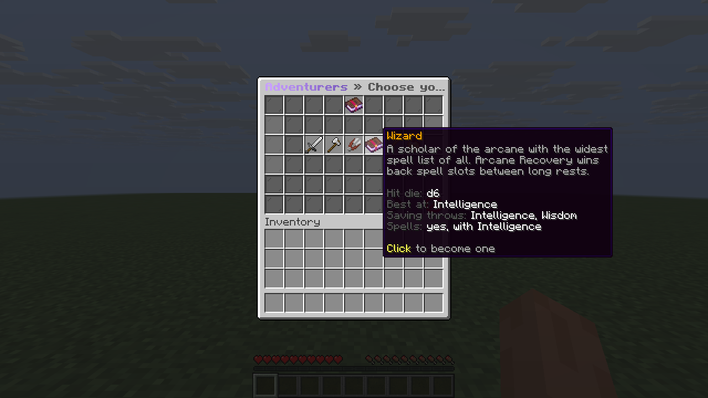 | 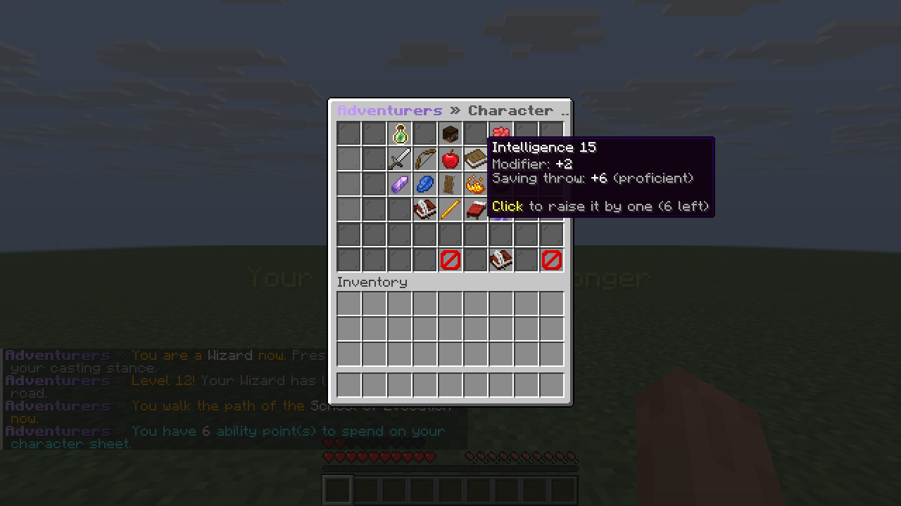 |
| 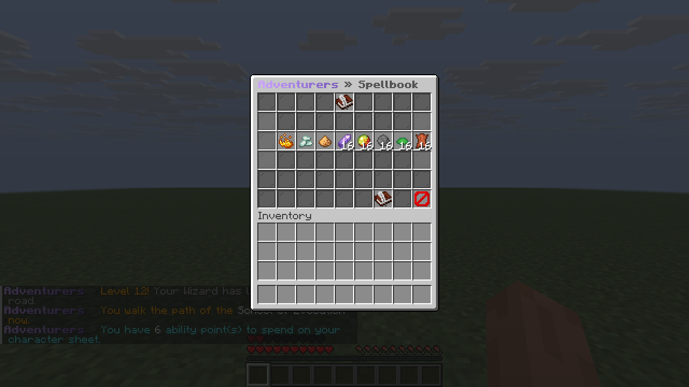 | 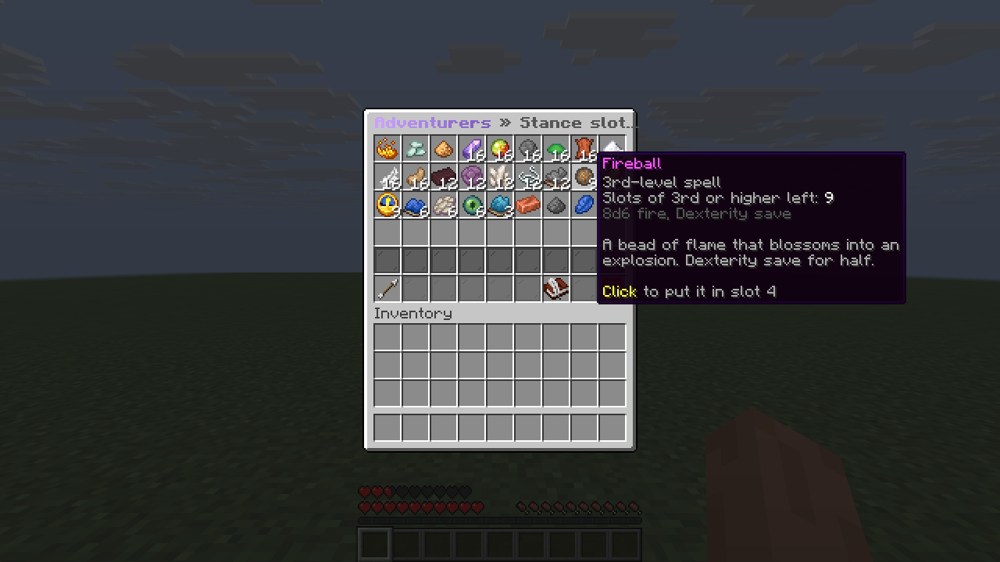 |
| 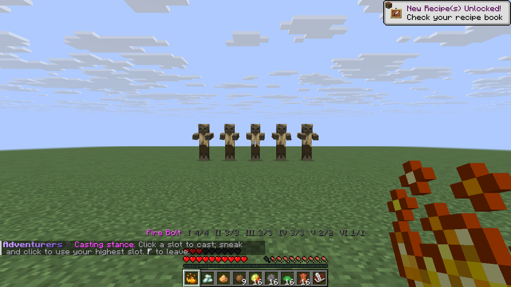 | 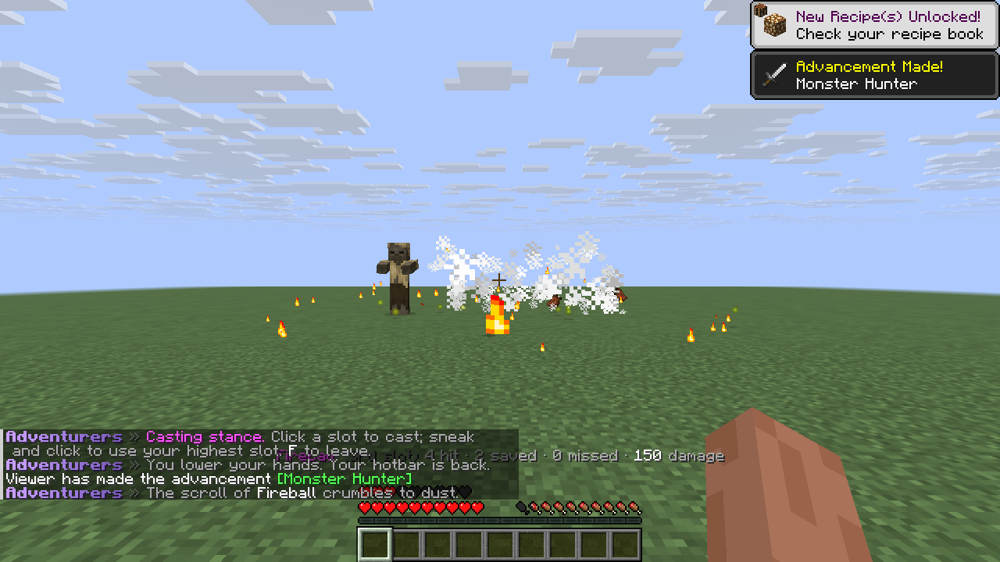 |
| 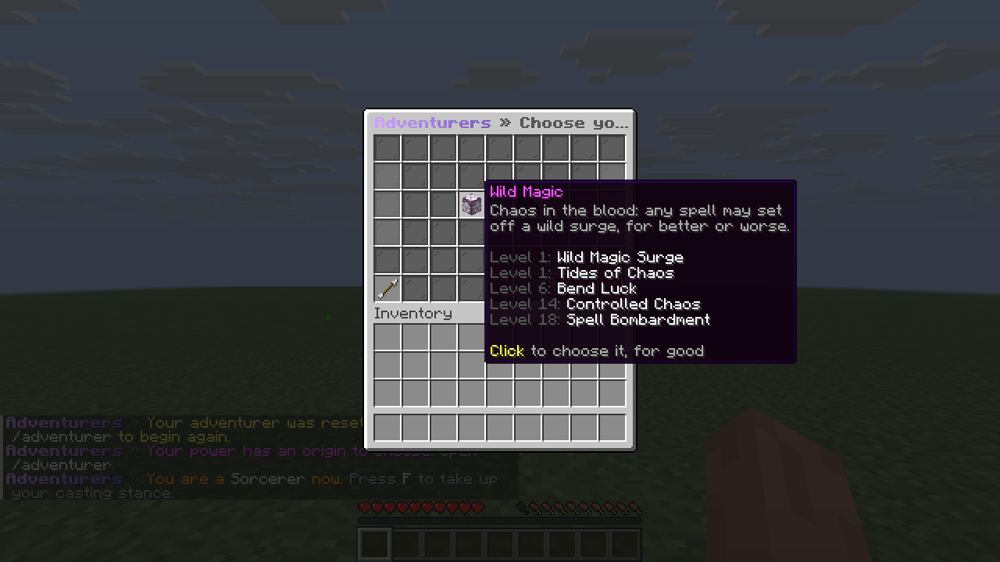 | 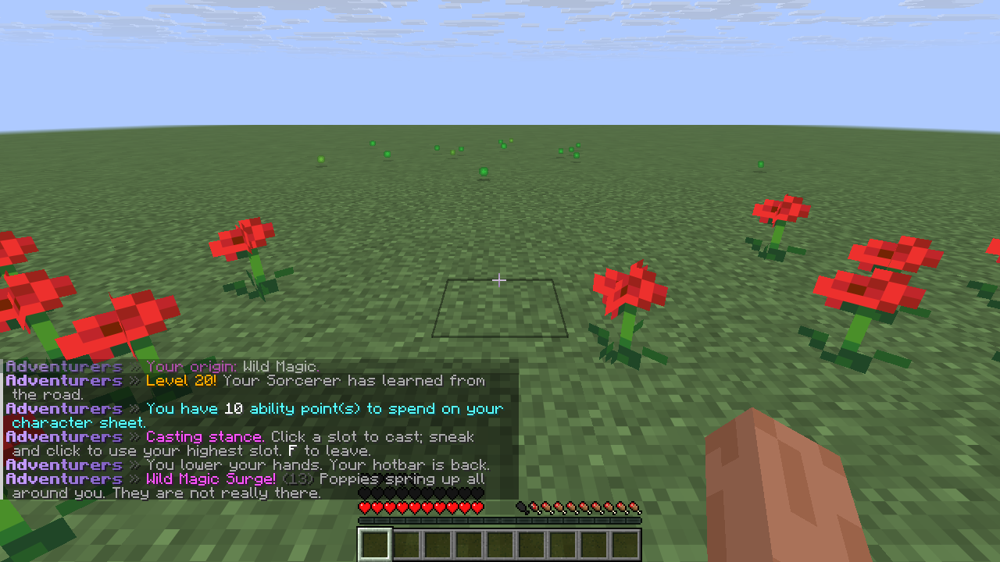 |
| 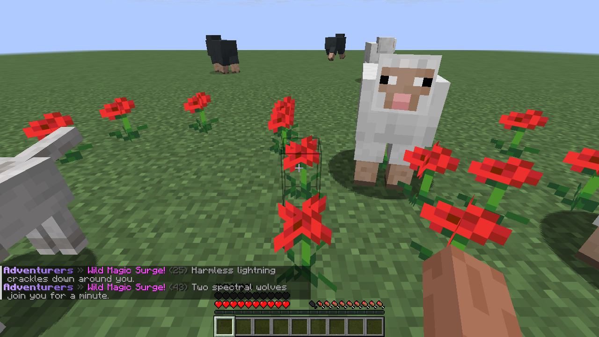 | 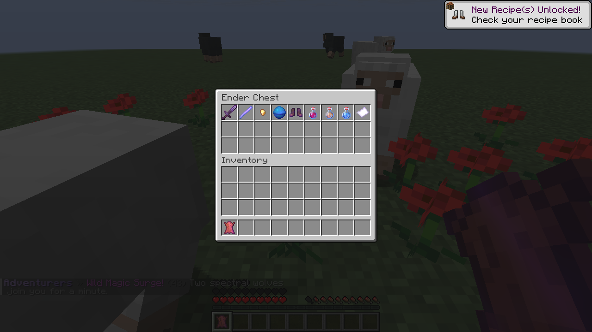 |

Its own looks (0.3.0) — every magic item modelled in Blockbench, a 32px icon for every spell, feature and class, the
designed character sheet:

| | |
|---|---|
|  |  |
| 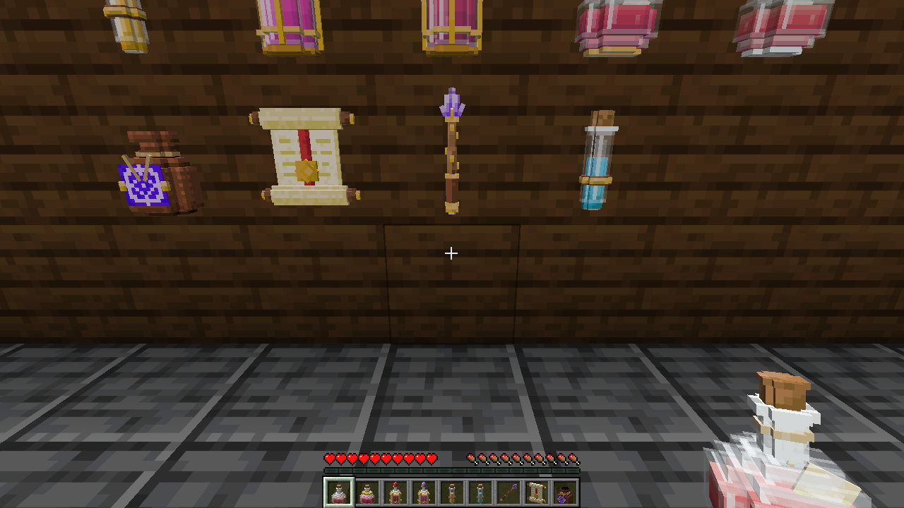 | 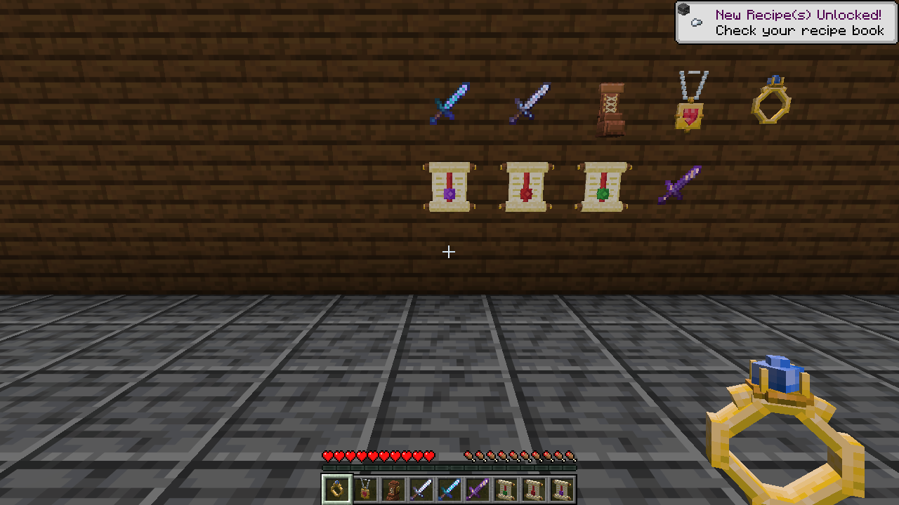 |
| 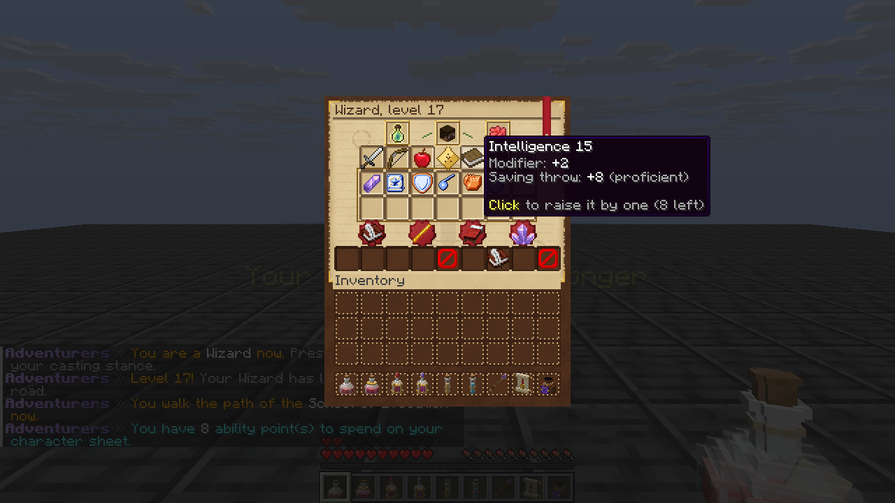 | 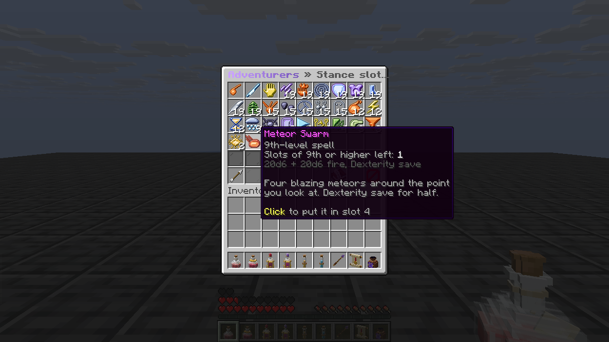 |

Taken with the real client by `AdventurersScreenshotsTest` and `AdventurersLooksScreenshotsTest` in
[e2e](https://github.com/RaindanceMC/e2e). The art is made in `dnd-module/art/`: `items/` (Blockbench models, built
through Blockbench's MCP plugin by `build.py`), `icons/` (`render.py`), `weapons/` (`runes.py`), `gui/` (`sheet.py`),
then `pack.py` writes the index the plugin ships from.

## Playing

- `/adventurer` (`/dnd`) — choose a class, then the character sheet: abilities, slots, features, spellbook.
- **F** (swap hands) — the casting stance: hotbar slots 1–8 become your spells and features, slot 9 your sheet (a sorcerer's metamagic). Click to cast; sneak and click to cast from your highest slot. F again and your hotbar is back.
- `/adventurer rest` — a short rest: stand still, unhurt, for 30 seconds. Sleeping through the night is a long rest.
- A new class always starts at level 1.
- **Subclasses**: Champion (fighter), Berserker (barbarian), Thief (rogue), Evocation (wizard), Life (cleric) come by themselves; a sorcerer chooses **Wild Magic** (an original d100 surge table, Tides of Chaos, Bend Luck, Controlled Chaos, Spell Bombardment) or **Draconic Bloodline** (scales, fire, dragon wings).
- **Magic items** drop from monsters by rarity: healing potions, Heroism, Speed, spell scrolls, +1/+2/+3 weapons and bows, a Wand of Magic Missiles, Ring of Protection, Amulet of Health, Boots of Striding and Springing, a Bag of Holding (your ender chest, anywhere).

Staff (`rainsadventurers.admin`):

- `/adventurer admin xp <player> <amount>` — adventure experience, levels follow
- `/adventurer admin level <player> <level>` · `rest <player>` · `reset <player>`
- `/adventurer admin give <player> <item> [spell]` · `surge <player> [1-100]`

Everything an owner can tune (worlds, experience, health per level, spell damage, damage against players, waits, rest lengths, wild surge chance, loot rate) is under `/settings` → Adventurers.

## Build

```
mvn install
```

Needs Java 25 and read access to `packages.tstieh.de` (server ids `packages-releases` / `packages-snapshots` in `~/.m2/settings.xml`). The end-to-end scenarios are `AdventurersScenarioTest` in [e2e](https://github.com/RaindanceMC/e2e).

## Versions

The module's version is `dnd-module.version` in the root `pom.xml`, the plugin's `plugin.version` in `dnd-standalone/pom.xml`. CI publishes every version not yet in the registry on the next push to master.

## Licence notice

This work includes material taken from the System Reference Document 5.1 ("SRD 5.1") by Wizards of the Coast LLC, available at https://dnd.wizards.com/resources/systems-reference-document. The SRD 5.1 is licensed under the Creative Commons Attribution 4.0 International License, available at https://creativecommons.org/licenses/by/4.0/legalcode. Rule names, spell names and numbers are adapted to real-time play; this plugin is not affiliated with or endorsed by Wizards of the Coast.
