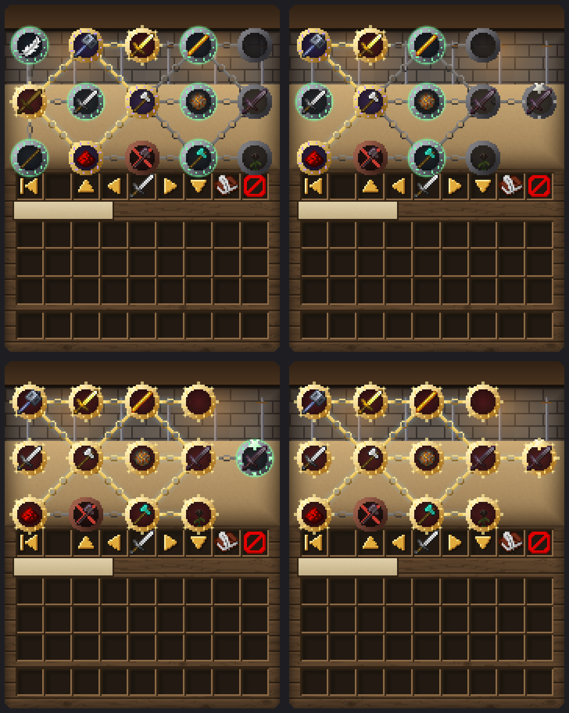
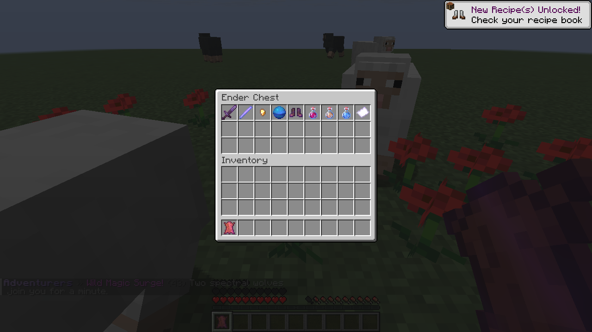
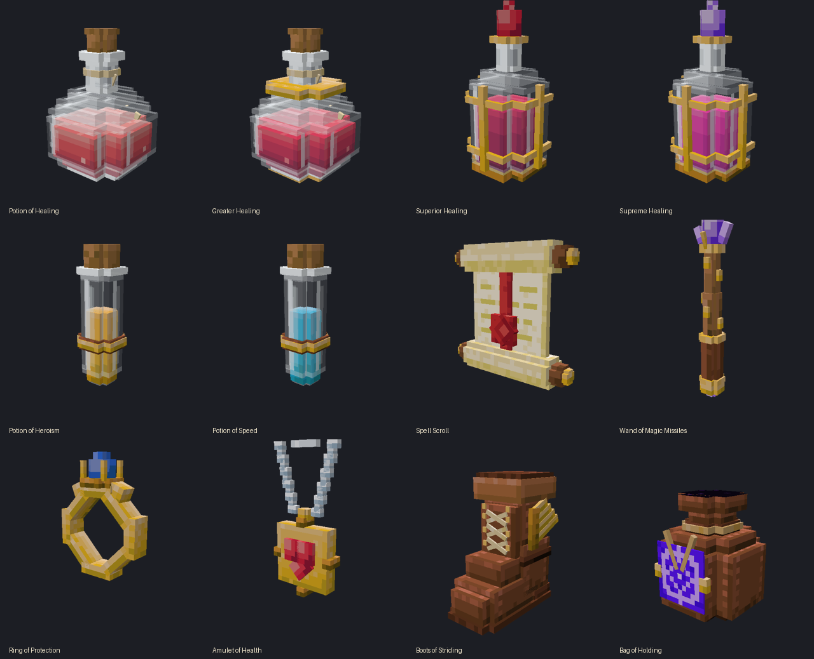
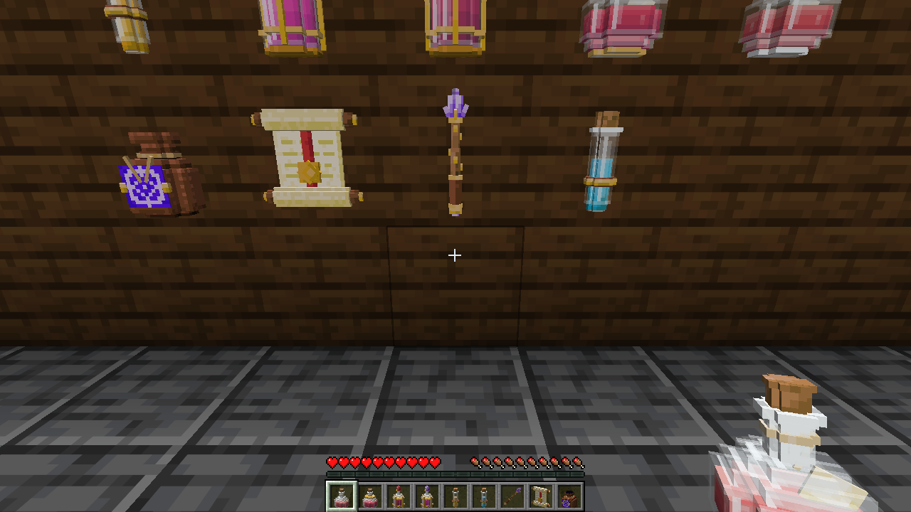
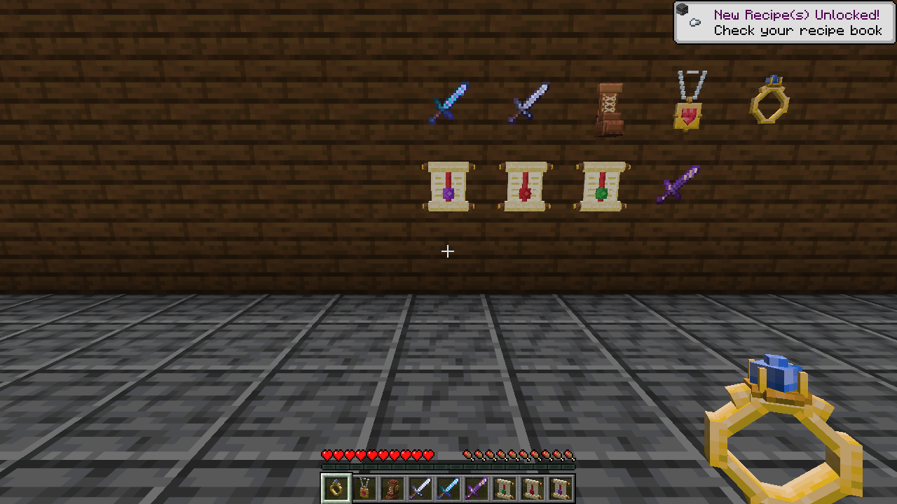
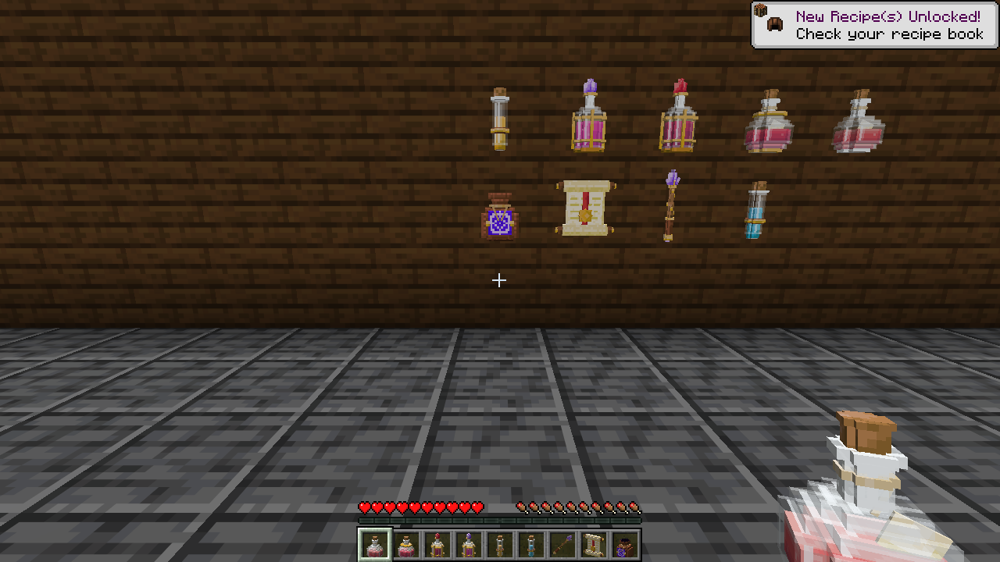

# RaindanceMC/skills

- **`skills-module`** — Rain's Flexible Modules — Skills: nineteen skills, each with a tree of its own, on one adventurer level earned from playing — never from ordinary monsters, so a mob farm pays nothing. A skill point every level up to a cap, spent in any skill's tree, so players specialise. Every branch ends in a mastery badge; magic items drop from monsters. Until 0.13.0 it was Adventurers (one tree, five branches), before 0.11.0 tabletop classes and spells; heroes keep their level, experience and every node they had.
- **`skills-standalone`** — Rain's Skills (`RainsSkills`): the module and the standard wrapper, shaded together.

Part of [RaindanceMC](https://github.com/RaindanceMC); built on [RainsCore](https://github.com/RaindanceMC/RainsCore) and the shared parent in [framework](https://github.com/RaindanceMC/framework).

## How it looks

| | |
|---|---|
|  |  |
|  |  |
|  |  |

The art is made in `skills-module/art/`: `items/` (Blockbench models, built through Blockbench's MCP plugin by
`build.py`), `weapons/` (`runes.py`), `gui/` (`parchment.py`), `tree/` (the trees' frames, chain and a painting per
branch on Core's `art/menus/tree.py` — `skilltree_art.py` with `nature_scenes.py` and `craft_scenes.py`; `preview.py`
lays a tree out), then `pack.py` writes the index the plugin ships from. The order of the paintings is
`SkillsPack.SCENES`; keep the two in step.

## Playing

- `/skills` (`/adventurer`, `/dnd`, `/character`) — every skill of every plugin, with your level, points and mastery; `/skills <skill>` opens that skill's tree. Fishing appears here too when RainsFishing runs.
- **Levels** come from playing, through Core's `Activities`: minutes not away, natural ores, harvests, fish, breeding, trades, enchanting, advancements, raids, bosses, digging, chopping, foraging, crafting, smelting, cooking, brewing, building, taming, new biomes, travel and anvil work. What a farm or a generator could do without end is capped per minute; spawner mobs and players who are away earn nothing.
- **Points**: one a level, up to `points-cap` (100), spent in any tree. A tree is wider and taller than the window: Core's arrows scroll it, shift-click a whole window. The middle button cycles the branches; shift-click it to unlearn one skill (once a day by default).
- **Mastery**: every branch ends in a free badge, open once the rest of the branch is taken, with a strong bonus of its own. All branches of a skill mastered and its glyph can be worn beside your name.

| Skill | |
|---|---|
| 🛡 Defense | Hearts, armour, healing — and a body that will not die. |
| ⚔ Melee | Harder, faster blows; two blades at once (**Dual Wielder** — the off hand strikes too, for half), or one great one. |
| 🏹 Archery | Arrows that hit harder, fly further and come back. |
| ✦ Agility | Quick feet, blows that miss you, knives in the back. |
| ✧ Magic | Scrolls, wands and potions at their full strength — and more to find. |
| ⛏ Mining | A faster pickaxe, ores twice over, whole veins at once and eyes for the dark. |
| ⚱ Excavation | A faster shovel, treasures in the dirt and luck under the brush. |
| 🪓 Woodcutting | A faster axe, whole trees felled, saplings and apples from the leaves. |
| ⚒ Smithing | Cheaper anvil work, never too expensive; salvage, sturdier gear, templates kept. |
| ☘ Farming | Fuller harvests, crops that plant and grow themselves, twins in the pasture. |
| ✿ Foraging | Berries, flowers and mushrooms: more of them, rare finds, bone meal that goes further. |
| ♨ Cooking | Meals that fill more and bless you, extra servings, a furnace that hurries. |
| ⚗ Alchemy | Potions that last longer and hit harder, a spare from the stand, ingredients saved. |
| ♞ Taming | Wolves and cats that bite harder and live longer, horses that run, leap and never fall. |
| ⚙ Artisan | Crafting and smelting: more from every craft, faster furnaces, ores that come out smelted. |
| ⌂ Building | Longer arms, blocks to spare — and blueprints, pasted from your own blocks. |
| ⚖ Trading | Lower prices, extra emeralds, trades that come back sooner. |
| ✪ Enchanting | Levels and lapis back, stronger offers, cheaper anvils. |
| ⚑ Exploration | Faster travel, wider maps, a compass that finds ruins and more in their chests. |

- **Blueprints** (Building's Architect branch): `/skills blueprint mark` hands you a marker for a box, `save <name>`, `paste <name>` (every block from your own inventory, every block asked about like one placed by hand), `list`, `delete <name>`, `undo`; with the Architect's Mastery `paste <name> rotate 90|180|270` and a ghost first.
- **Magic items** drop from monsters by rarity (never from spawners or while away, at most four an hour): healing potions, Heroism, Speed, spell scrolls (Magic Missile, Fireball, Lightning, Healing, Misty Step, Shield; tier 1–5), +1/+2/+3 weapons and bows, a Wand of Magic Missiles, Ring of Protection, Amulet of Health, Boots of Striding and Springing, a Bag of Holding (your ender chest, anywhere). The Potion of Mach Fuck is brewed from a dragon head.

Staff (`rainsskills.admin`):

- `/skills admin xp <player> <amount>` — adventure experience, levels follow
- `/skills admin level <player> <level>` · `unlearn <player>` · `reset <player>`
- `/skills admin give <player> <item> [scroll] [tier]`

Everything an owner can tune (worlds, experience, the points cap, loot rate, how much counts between players, how often a skill may be unlearnt, the Mach potion) is under `/settings` → Skills. The module id, its settings and its database are still called `dnd`, so a server's settings and heroes stayed where they were.

## Build

```
mvn install
```

Needs Java 25 and read access to `packages.tstieh.de` (server ids `packages-releases` / `packages-snapshots` in `~/.m2/settings.xml`). The end-to-end scenarios are `SkillsScenarioTest` and `SkillsScreenshotsTest` in [e2e](https://github.com/RaindanceMC/e2e).

## Versions

The module's version is `skills-module.version` in the root `pom.xml`, the plugin's `plugin.version` in `skills-standalone/pom.xml` (and `ModuleInfo` in `SkillsModule`). CI publishes every version not yet in the registry on the next push to master.

## Licence notice

This work includes material taken from the System Reference Document 5.1 ("SRD 5.1") by Wizards of the Coast LLC, available at https://dnd.wizards.com/resources/systems-reference-document. The SRD 5.1 is licensed under the Creative Commons Attribution 4.0 International License, available at https://creativecommons.org/licenses/by/4.0/legalcode. Magic item names and some spell names are kept from it; this plugin is not affiliated with or endorsed by Wizards of the Coast.
